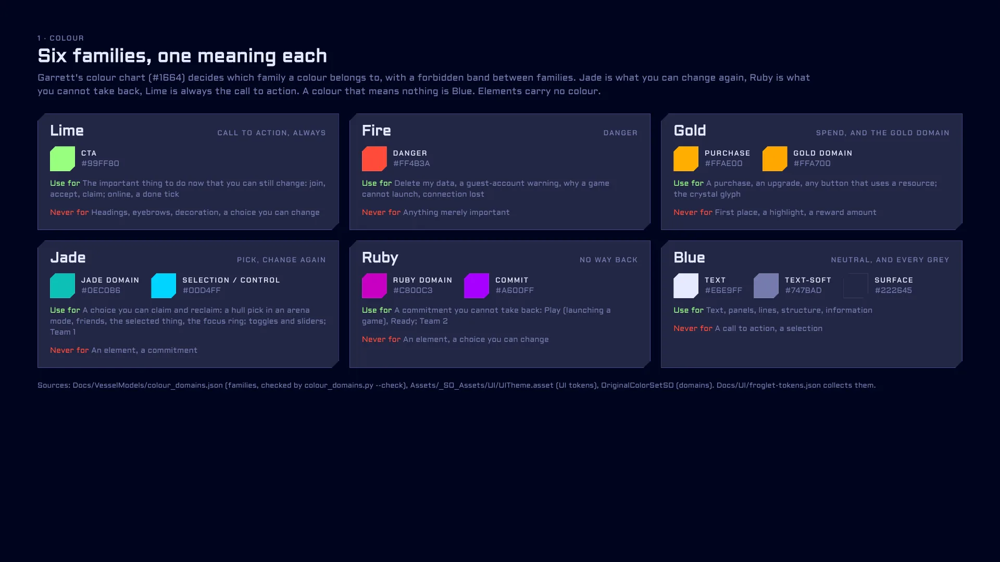
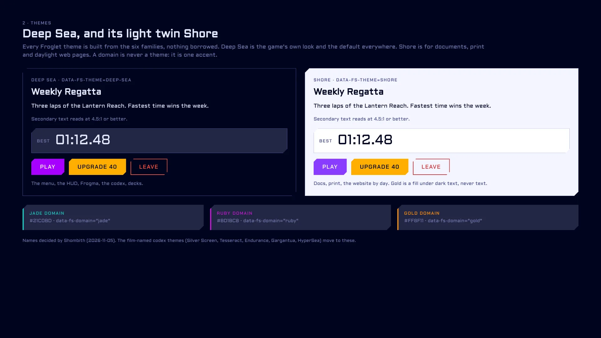
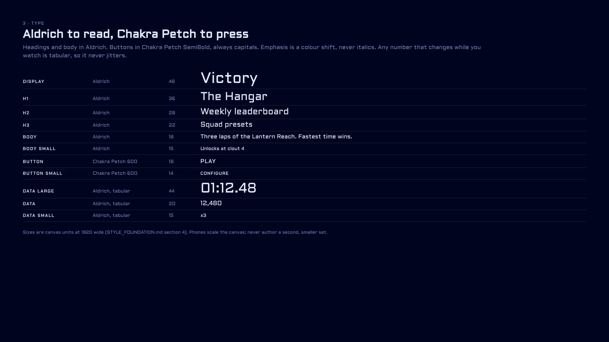
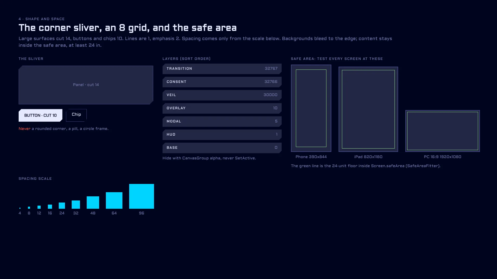
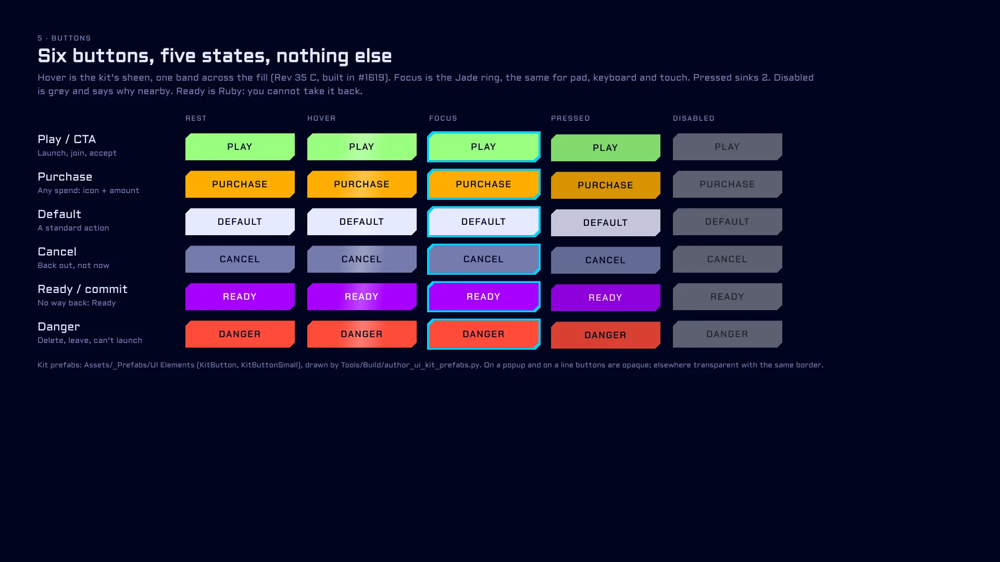
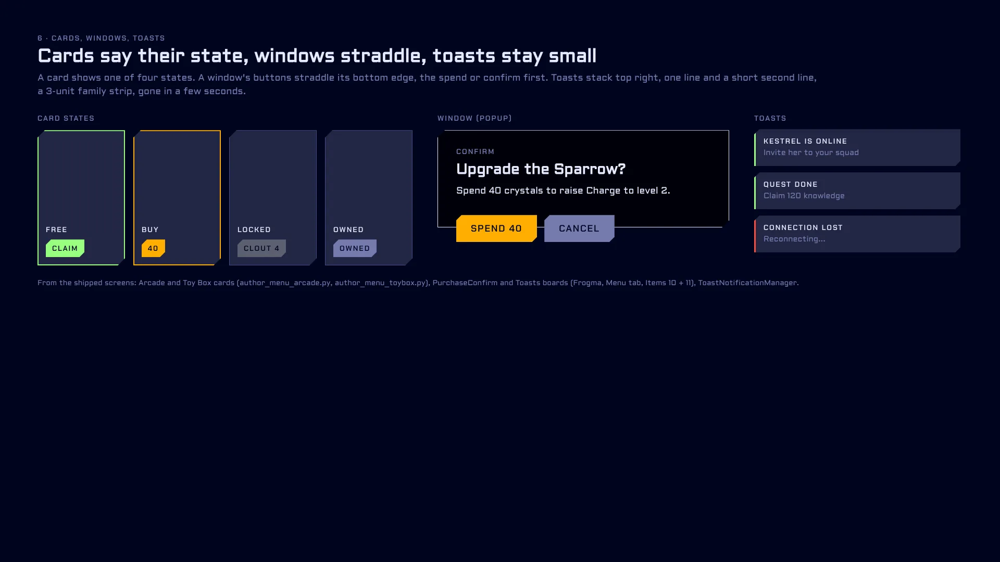
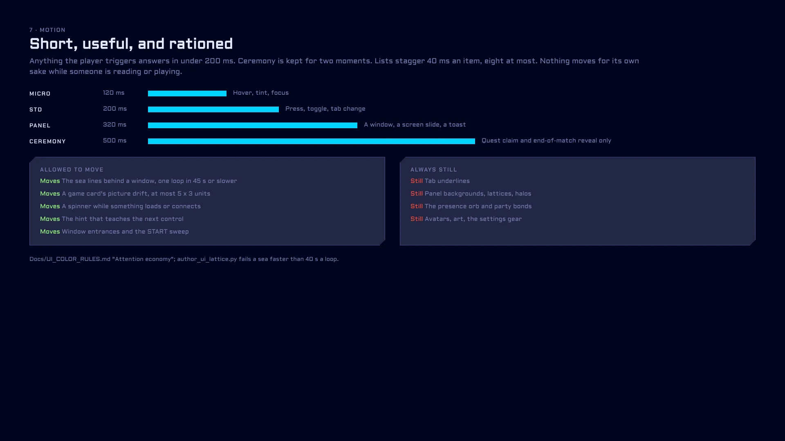

# Froglet UI style guide

**One look for everything Froglet makes.** This is the guide every new screen is checked against: menus and HUD in the
game, boards on Frogma, artifacts and diagrams, decks, the website, the Fleet Codex and every studio. It is written for
the whole team, programmers or not. Each rule says what to do and what not to do, and both point at one of our own
screens.

- **See it drawn:** the **Style Guide** tab, the first page of Frogma (https://claude.ai/artifact/W8DBZaW6pu3L28egCjrKo2).
  The pictures below are those boards; the source that draws them is `Docs/MenuRedesignB/rounds/style_guide_boards.py`.
- **Use the tokens, never type a colour:** in Unity the `UIThemeSO` (`Assets/_SO_Assets/UI/UITheme.asset`) and the kit
  prefabs; on any web page `Docs/UI/froglet.css` (or `Docs/UI/froglet-tokens.json` in a tool). Both are written from the
  game's own assets by `python3 Tools/Build/froglet_style.py` (`--check` is the gate).
- **Where the numbers come from:** colour families are Garrett's colour chart, `Docs/VesselModels/colour_domains.json`
  (PR #1664, `COLOR_DOMAINS.md`); what each UI colour means is `Docs/UI_COLOR_RULES.md`; type, shape, spacing, layers
  and motion are `Docs/STYLE_FOUNDATION.md` v0.3.3. This guide does not change a number; when they disagree it says so
  and leaves a **[decision]** for Shombith (section 13).

Owner: Shombith (UI, colour tokens, Frogma). Colour families: Garrett. Started 2026-11-03.

---

## 1. Colour: six families, one meaning each

Every colour belongs to one of six families, and each family means one thing. A colour that means nothing is Blue.
Garrett's chart decides which family a colour is in and keeps a **forbidden band** between families, so two meanings
never look alike (`python3 Tools/Build/colour_domains.py classify '#hex'` answers for any colour).

| Family | Means | Use it for | Never for | UI token |
|---|---|---|---|---|
| **Lime** | Call to action | launch, join, accept, confirm, an earned reward, "online", a done tick | headings, eyebrows, decoration | `cta` `#99FF80` |
| **Fire** | Danger | delete my data, a guest-account warning, why a game cannot launch, connection lost | anything merely important | `danger` `#FF4B3A` |
| **Gold** | Spend, and the Gold domain | a purchase, an upgrade, any button that uses a resource; the crystal glyph | first place, a highlight, a reward amount | `purchase` `#FFAE00` |
| **Jade** | Order: the Jade domain (Team 1) | Jade players; active toggles, sliders, scrollbars | an element, a status | `controlActive` `#00D4FF` |
| **Ruby** | Freedom: the Ruby domain (Team 2) | Ruby players; tooltip boxes | an element, a warning | `tooltip` `#A600FF` |
| **Blue** | Neutral, and every grey | text, panels, lines; the one selected thing and the focus ring | a call to action | `textLight`, `neutralLightest`, `surface*`, `selection` |

- **Do:** the Rev 37 Connection Lost window (Frogma, Menu Redesign tab, `R37Lost`) uses Fire for the one line that says
  what went wrong, and Lime only for RECONNECT.
- **Don't:** the leaderboard row's own teal `#1AB2B2` (`LeaderboardsMenu.cs`) and the score-gain green `#33FF66`
  (`ScoreNumberAnimator`) are colours with no family and no token.

**Elements carry no colour (LOCKED, Garrett 2026-10-24).** Charge, Mass, Space and Time are told by the glyph's shape,
by animation and by effects, never by a fixed hue.
- **Do:** today's ability lockup draws every element in one neutral (`AbilityLockupStyle.asset`, `elementColour` off).
- **Don't:** the Rev 3 HUD boards (`R3HudSquirrel` and the rest: "element colours drifting like a lava lamp").

**The three domains** (Jade, Ruby, Gold) are teams. Only a team thing wears one: your score, your avatar chip, your
domain panel. The game draws them from `OriginalColorSetSO` (Jade `#0EC0B6`, Ruby `#C800C3`, Gold `#FFA700`).
**[D2: the UI tokens and STYLE_FOUNDATION use `#00D4FF` / `#A600FF` / `#FFAE00` for the same domains; pick one set.]**

## 2. Themes: Deep Sea and Shore

Froglet's themes are built only from the six families. Nothing is borrowed from a film or another product.

| Theme | Where | Ground | Text | Notes |
|---|---|---|---|---|
| **Deep Sea** (default) | the game, Frogma, the codex, decks, artifacts | `#00041F` over `#00010A` | `#E6E9FF`, soft `#747BAD` | the game's own UITheme values |
| **Shore** (light twin) | documents, print, the website by day | `#F4F5FF` | `#00041F`, soft `#434C89` | each family re-picked inside itself at 4.5:1; gold is a fill under dark text, never text |

A **domain is never a theme**: a page that belongs to a team adds one accent with `data-fs-domain="jade|ruby|gold"`.
On the web: `<html data-fs-theme="deep-sea">` (or `shore`, or `auto` to follow the viewer's light/dark setting) and
`var(--fs-text)`, `var(--fs-cta)` and so on from `froglet.css`.
- **Do:** the menu's ground and sea lines (Arcade, Toy Box, Configure windows) are Deep Sea.
- **Don't:** a page in a theme of its own (the Fleet Codex's Silver Screen, Tesseract, Endurance, Gargantua and HyperSea
  are film looks; they move to Deep Sea and Shore). **[D1: are the names Deep Sea and Shore right?]**

## 3. Type and numbers

**Aldrich** to read (headings and body), **Chakra Petch SemiBold** to press (buttons, always capitals). Sizes at 1920
wide: Display 48, H1 36, H2 28, H3 22, Body 18, Body small 15, Button 18, Button small 14, Data 44 / 20 / 15.
- Emphasis is a colour shift, never italics or bold for its own sake.
- Any number that changes while you watch (score, timer, count, rank, balance) is tabular (`<mspace>` in TMP,
  `font-variant-numeric: tabular-nums` on the web) so it never jitters.
- **Do:** the Rev 33 D countdown and the HUD timer hold their width as the digits change.
- **Don't:** a second, smaller type set for phones. The canvas scales; the sizes do not change.
  **[D6: confirm phones scale the 1920 canvas rather than use STYLE_FOUNDATION's mobile @800 column.]**

## 4. Shape and spacing

- **The corner sliver:** two opposite corners cut, 14 on large surfaces, 10 on buttons and chips. Nothing is rounded.
  Hexagons only for icon-only nav tiles and slider handles. Lines are 1, emphasis 2.
- **Spacing:** only from the scale `4 8 12 16 24 32 48 64 96`.
- **Layers:** base 0, hud 1, modal 5, overlay 10, veil 30000, consent 32766, transition 32767. Hide a panel with its
  CanvasGroup alpha, never `SetActive` (its subscriptions must keep running).
- **Do:** the kit prefabs (`KitButton`, `KitTopNavTab`, the windows) all cut the same sliver.
- **Don't:** rounded pills or circle frames (the Rev 6 friends orb, `R6FriendsOrb`, was not taken forward).

## 5. Buttons and their states

Five buttons: **Play / CTA** (lime), **Purchase** (gold, icon + amount), **Default** (light), **Cancel** (soft
neutral), **Danger** (fire). Five states, the same on every button:

| State | Looks like | Why |
|---|---|---|
| Rest | the variant's fill (opaque on a popup or a line, transparent with its border elsewhere) | |
| Hover | one soft sheen across the fill, nothing moves | Rev 35 C, picked and built (#1619) |
| Focus | the selection-blue ring, the same for pad, keyboard and touch | `Docs/UI_COLOR_RULES.md`, 2026-10-24 |
| Pressed | sinks 2 and darkens | |
| Disabled | grey, with the reason next to it | |

- **Do:** the Arcade card's PLAY and the purchase confirm's SPEND 40 (Frogma, Menu tab, Items 3 and 10).
- **Don't:** an element-coloured button (the Mass / Space / Time variants are retired and draw as Default).

## 6. Cards, windows and toasts

- **Cards** show one of four states: free (lime edge, CLAIM), buyable (gold edge, price), locked (grey, "Unlocks at
  clout N"), owned (soft neutral). A game card's picture may drift slowly (section 7).
  Do: the Arcade and Toy Box cards (`author_menu_arcade.py`, `author_menu_toybox.py`).
- **Windows (popups):** `#00010A` panel, 1-unit light border, sliver corners; the buttons **straddle** the bottom edge,
  confirm or spend first, Cancel second. Do: `PurchaseConfirm` (Frogma, Items 10 + 11).
  Don't: an unpacked scene copy of a window (`MaelstromGameConfigurationModal` and `ArenaGameConfigureModal` copy
  `ArcadeGameConfigureModal.prefab`; they should be variants).
- **Toasts:** top right, a title and one short line, a 3-unit family strip, gone in a few seconds.
  Do: the Toasts board. Don't: a toast that holds a decision; that is a window.

## 7. Motion

| Token | Time | Use |
|---|---|---|
| micro | 120 ms | hover, tint, focus |
| std | 200 ms | press, toggle, tab change |
| panel | 320 ms | a window, a screen slide, a toast |
| ceremony | 500 ms+ | a quest claim and the end-of-match reveal only |

Lists stagger 40 ms an item, eight at most. **Nothing moves for its own sake while someone reads or plays.** Allowed:
the sea lines (one loop in 45 s or slower), a card picture's drift, a spinner while loading, the hint that teaches the
next control, window entrances and the START sweep. Always still: tab underlines, panel backgrounds, halos, the
presence orb and party bonds, avatars and art. Respect "reduce motion" (froglet.css zeroes the durations).
- **Do:** the Rev 12 / 13 sea lines Shombith picked ("keep it a bit slow").
- **Don't:** the old breathing rings, scan line and motes in the Hangar bay (removed 2026-10-24).

## 8. Safe area and phone layout

- Backgrounds bleed to the edge; content sits inside `Screen.safeArea` with at least 24 units of padding
  (`SafeAreaFitter` on every canvas that carries player-facing content).
- Test every screen at **phone 390 x 844**, **iPad 820 x 1180** and **PC 16:9, 16:10 and 21:9**.
- Touch targets are at least 44 units; nothing important sits under a notch, a home bar or a thumb's resting place.
- **Do:** `ConnectingPanel` carries its own `SafeAreaFitter`.
- **Don't:** the Hangar's four canvases have no `SafeAreaFitter` (section 12).

## 9. Words

Every word a player reads is a field a person can edit (CLAUDE.md, LOCKED): a serialized string, or an authored
template filled with `TemplateText.Fill`. An empty field shows nothing.
- **Do:** the toast config's authored lines.
- **Don't:** `PrivacyConsentOverlay.cs` builds its words and colours in code.

## 10. Shared prefabs

`GameCanvas.prefab`, the kit prefabs and every window are single sources of truth (`Docs/GAMECANVAS.md`): change the
prefab, or make a **variant**; never park overrides in a scene and never copy a prefab.
- **Do:** the GameCanvas Unifier retired the forked copies (`GameCanvas-SkimRace.prefab` is gone).
- **Don't:** `BenchmarkStressTest.unity` (106 overrides) and `ArcadeGameMultiplayer2v2CoOpVsAI.unity` (73) still
  carry GameCanvas overrides.

## 11. The UI checklist (every UI pull request answers it)

A pull request that touches **`Assets/_Prefabs/UI*`, `Assets/_Scenes/Menu_Main.unity`, `GameCanvas`, the UI theme or
`Assets/_Scripts/UI/`** fills in the **UI checklist** section of the pull-request template
(`.github/pull_request_template.md`). The **UI checklist** workflow (`.github/workflows/ui-checklist.yml`, run by
`Tools/Build/check_ui_pr.py`) fails while a box is left unanswered, and CODEOWNERS asks Shombith to review.

- [ ] **Theme tokens:** every colour comes from `UIThemeSO` / the kit (or `froglet.css` on the web); none typed in.
- [ ] **Families:** each colour means its family's meaning (section 1); elements carry no colour.
- [ ] **Safe area:** tested at phone 390x844, iPad 820x1180 and PC 16:9 / 21:9, content inside the safe area.
- [ ] **Focus:** every control reachable with a gamepad and by touch; focus shows the selection ring.
- [ ] **Shared prefabs:** no scene-level overrides on a shared prefab; changed on the prefab or a variant.
- [ ] **Words:** every player-facing word is an authored field.
- [ ] **Board:** matches its picked Frogma board, or says why not.

Each box is ticked, or marked `N/A` with a reason. **The design-review step:** a new screen is drawn and picked on
Frogma before it is built (`Docs/MENU_REDESIGN_B.md`, the three gates); the reviewer opens the picked board beside the
build and this checklist, and `/ui-redesign-tracker` verifies the build against the board.
**[D7: should the UI checklist workflow be a required check on bleeding-edge?]**

## 12. The five screens that break the guide most today

Measured 2026-11-03 (prefab colour counts, scene overrides, gates). Not fixed here; each is one line of work.

| # | Screen | What breaks | One-line fix |
|---|---|---|---|
| 1 | **Settings window** (`UI Elements/Panels/OptionsMenuContent.prefab`, the `SettingsModal` in Menu_Main) | 43 typed-in colours, no theme binding; a second, themed Settings (`SettingsView.prefab`) also lives | Retire `OptionsMenuContent` for the themed `SettingsView`, or bind it to the kit's themed graphics. |
| 2 | **Connecting / connection lost** (`UI Elements/In Game/ConnectingPanel.prefab`) | 39 typed-in colours against 10 theme bindings; the pre-kit look | Re-skin onto the kit prefabs and theme tokens, then the in-editor approval of item 13. |
| 3 | **In-game HUD** (`CORE/GameCanvas.prefab`, 46 scenes) | 34 typed-in colours (13 values); overrides in 4 scenes, 106 in `BenchmarkStressTest` | Apply the uniform overrides to the prefab, clear the two outliers, bind the colours to tokens. |
| 4 | **Privacy and age gate** (`Scripts/UI/Privacy/PrivacyConsentOverlay.cs`) | builds colours (and words) in code; no tokens for secondary, tertiary, placeholder and link text | Add the four text tokens to `UIThemeSO` and read them; move the words to authored fields. |
| 5 | **Hangar** (`Main Menu Screens/Hangar/HangarView.prefab`) | 4 canvases without a `SafeAreaFitter`; open review asks (R5 in `UI_REDESIGN_TASKS.md`) | Add `SafeAreaFitter` to each Hangar canvas, then finish the R5 items. |

Also noted: Ark (`ArkView.prefab`, the most typed-in colours, mostly themed), Brittle Star HUD (20 colours built in
code), the leaderboard teal and score-gain green (no tokens), the two unpacked configure windows, and the element
tints still in five vessel HUDs (`StarlingHUDView`, `GobyPistolButtons`, `OrcaHUDController`, `TouchControlsHud`,
`AbilityLockupView`; other people's HUD code, ask first).

## 13. Decisions only Shombith can make

- **[D1]** Theme names: Deep Sea (dark, default) and Shore (light). Keep, or name them?
- **[D2]** The domain colours: the game palette (Jade `#0EC0B6`, Ruby `#C800C3`, Gold `#FFA700`) or the UI tokens
  (`#00D4FF`, `#A600FF`, `#FFAE00`)?
- **[D3]** The selection blue `#3DB2FF` sits in the forbidden band between Blue and Jade: move it into Blue, or ask
  Garrett to reshape Blue?
- **[D4]** Five of STYLE_FOUNDATION's light and dark domain variants fall outside their family on Garrett's chart:
  Jade Light `#80EAFF` and Ruby Light `#D280FF` (in the band), Jade Dark `#004D81` (Blue), Ruby Dark `#530080` and Gold
  Dark `#805700` (in the band). Re-pick them inside their families?
- **[D5]** STYLE_FOUNDATION section 3 still says focus and selection are CTA green; `UI_COLOR_RULES.md` (2026-10-24)
  made them the selection blue. This guide follows the newer rule; update STYLE_FOUNDATION to match?
- **[D6]** Phones scale the 1920 canvas (no second type set)?
- **[D7]** Make the UI checklist workflow a required check?
- **[D8]** Move the Fleet Codex and the studios off their film themes onto Deep Sea and Shore (a follow-up change)?

## 14. Outside the game: artifacts, diagrams, decks, the website, the codex

- Link the fonts (Aldrich, Chakra Petch 500/600/700 from Google Fonts) and the tokens: copy `Docs/UI/froglet.css`
  into the page, or read `froglet-tokens.json` in a generator. Set `data-fs-theme` on `<html>`.
- Deep Sea by default; Shore for documents meant to be printed or read in daylight.
- Diagrams: Blue lines and labels; a family colour only where the thing means that family (a danger path in Fire).
  Never one colour per element.
- Decks: one idea per slide, H1 36 / Body 18 scaled to the slide, the sliver on panels, no gradient washes or glows.
- A Frogma board copies the latest round's helmet (fonts and the `.sl` sliver) and these tokens.
