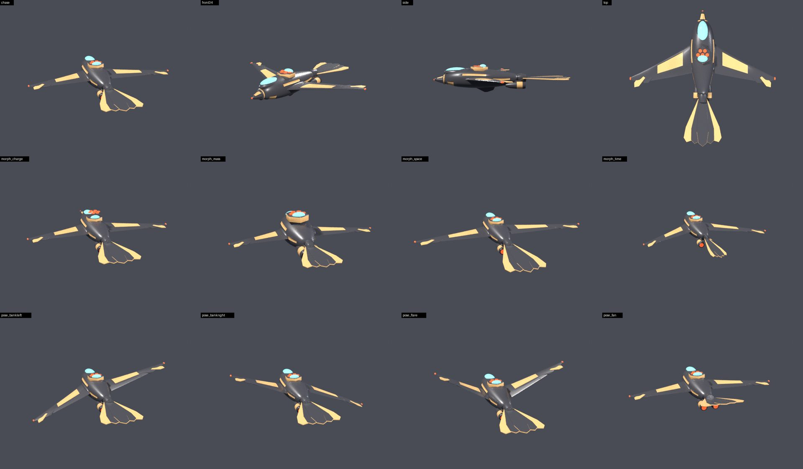

# Honeyguide: the Honeyguide and Ratel's hull

> A NEW hull (2026-10-21), built by `/vessel-model` from `Tools/Build/vessel_model/specs/honeyguide.py` to the fleet
> convention (`.claude/skills/vessel-model/references/FLEET_CONVENTION.md` 1-4). There is no artist file.
> `Honeyguide.prefab` draws it (`author_honeyguide_assets.py` `model_retrofit`, the Wrasse's pattern); the Sparrow's
> mesh renderer is off, its bones, jets, colliders and Animator stay, so the hull still flies the Sparrow's airframe.
> The vessel itself: `Assets/_Scripts/Controller/Vessel/Crew/HONEYGUIDE.md`.

## Brief

Garrett, 2026-10-21: "Get everything including models etc. Together so we are ready to /ship". Two seats share one
hull: the Honeyguide (a small bird that leads the way) flies, the Ratel (the honey badger that breaks the hive open)
plays the Dynamo. The ship is inspired by both and is neither animal:

| clade | ship |
|---|---|
| stubby beak | **sensor beak** (`beak`): a short faceted cone with a glowing sensor tip |
| the Ratel on its back | **Ratel turret** (`ratel`): a low hexagonal turret behind the canopy, seven glowing hex cells (the Dynamo's board) under a glass hood |
| long pointed wings | swept wings (`wing.L` / `wing.R`) with a sunk domain panel, three overlapping primaries and a nav light |
| outer tail feathers | **tail fan** (`tail`): five overlapping vanes on a hub, the outer two domain |
| stout body | a gunmetal fuselage with a domain saddle, chin and flank bands, a cyan canopy, a keel and two nacelles on pylons |

## Rig contract

- **File**: `Assets/_Models/Vessel Models/Honeyguide.fbx`, guid `4f1c2a9e7b3d4e5f8a6b0c1d2e3f4a5b`. The `.meta` is
  Grouper's with the guid changed: all four slots remap to the shared materials.
- **Preset** `zup`: nose at Unity +Z, up +Y, the model root at identity under the hull root.
- **Nodes**: mesh `mesh`, armature `rig`; root bone `hull`. Bones (rigid, one per part): `hull`, `beak`, `ratel`,
  `wing.L`, `wing.R`, `tail`.
- **Slots**: 0 Domain, 1 Body, 2 Window, 3 Engine (polygons 517 / 2821 / 416 / 382). 3820 verts, 7488 tris.
- **Size**: the Sparrow's drawn hull (span 12.5, length 12.2) held to 10%; the turret makes it taller.
- **Shape keys**, as travel in % of the diagonal (`measure_vessel_models.py --only Honeyguide`: 4 labelled, 4 move):

| key | meaning | what moves | travel |
|---|---|---|---|
| Charge | weapon | the beak juts into a lance; the turret's cells rise | 8.5% |
| Mass | volume | the body, turret and nacelles swell; the wings ride out | 4.9% |
| Space | reach | the wings reach 1.28x along their span; the tail fan lengthens | 8.6% |
| Time | speed | the wings sweep back; the tail fan closes to a dart | 12.9% |

- **Takes**: none drive it. `HoneyguideBody` poses the bones by name from the hull's measured motion (wings bank into a
  turn, beat below cruise and flare when the hull slows hard; the tail steers out of a turn and lifts with the pitch;
  the turret turns 60 degrees per Dynamo spin on the crew's machine). Four documentation poses for the sheet, held by
  `pose_expect`: `bankleft`, `bankright`, `flare`, `fan`.

## Gates

- `python3 Tools/Build/vessel_model/build.py Tools/Build/vessel_model/specs/honeyguide.py --check` (the FBX rebuilds).
- `python3 Tools/Build/vessel_model/render_cards.py Honeyguide --check` (the five card images are this model's).
- `python3 Tools/Build/author_honeyguide_assets.py --check` (the prefab draws it, the class asset names the cards, the
  four fusion entries are bake-free).
- `HoneyguideTests.HoneyguideHull_DrawsItsOwnModel_WithFourElementMorphs_AndTheBonesItsBodyPoses` (editor).

## Open

- The crystal hull fusion bakes: the four entries are bake-free (the Sparrow's bakes were of the Sparrow's mesh), so the
  fusion solves at runtime until someone runs **FrogletTools > Vessels > Wiring > Bake Crystal Hull Fusions** in the
  editor.
- `VesselAnimation.SkinnedMeshRenderer` is serialized on the hidden Sparrow mesh (an FBX sub-object id cannot be
  written offline); `HoneyguideBody.Awake` hands it the drawn mesh so the boost flare lights the Honeyguide. The Wrasse
  has the same gap and no such hand-off.
