# Amoebius (the app)

Amoebius is Froglet's own engine for Cosmic Shore, and this is its app: one `.exe` for anyone who
works on or tests the game. Pick a branch, press **START**: Amoebius fetches that branch, builds it
from its own source and runs it - and records the run. It also builds phone apps, keeps the
engine's Project Settings, tracks every play run, keeps a task and bug board, and has the **Amoebius Agent, powered by Claude**, built in.

Source: `Port/src/CosmicShore.Launcher` (C#, Dear ImGui on our own Silk.NET window).

## Getting the .exe

- **From Unity (the everyday way): FrogletTools > Amoebius > Launch Amoebius.** It builds
  `Amoebius.exe` from the checkout the editor has open into `Library/Amoebius` and opens it. After a
  pull it rebuilds by itself (it compares the launcher's source files with the last build); a first
  build takes a minute or two, later launches open at once. *Rebuild Amoebius* forces a build, *Show
  Amoebius Folder* reveals the .exe. With no .NET 10 SDK yet it opens the copy in
  `Port/dist/Amoebius-Windows.zip` instead; press START in Amoebius once (it installs its own SDK) and
  later launches build from source. Source: `Assets/_Scripts/Editor/LaunchAmoebius.cs`.
- Without Unity: `Port/dist/Amoebius-Windows.zip` (one file), or double-click `Port\build-launcher.bat`.

| Needed | Why | If missing |
|---|---|---|
| git (GitHub Desktop is enough) | fetches the branch | install GitHub Desktop |
| .NET 10 SDK | compiles the branch | installed automatically on the first START |
| ~3 GB of disk | project files + build output | - |

## Pages (left rail)

| Page | What it is for |
|---|---|
| **PLAY** | Branch, **START** (offline) and **START ONLINE** (UGS, below), and three quick toggles (fullscreen, audio, pull first). The small buttons beside them update without playing and open the workspace folder. |
| **BUILD** | One card per phone platform. Each card has one choice and one button; everything else is under *Options*. |
| **PROJECT** | The engine's own Project Settings (below). |
| **AGENT** | The Amoebius Agent, powered by Claude: as many chats as you like, side by side (below). |
| **GIT** | What the agent (or you) changed in the workspace, and getting it to GitHub (below). |
| **EDITOR** | TOOLS (every FrogletTools tool, run by the agent), DATA (the data sets, editable) and MODELS (every model in the game's colours; VIEW IN ENGINE) (below). |
| **VESSEL STUDIO** | The Vessel Studio inside Amoebius: pick a vessel (Squirrel, Stoat, or ALL STUDIOS for the hub), then one row of actions for it: **OPEN IN AMOEBIUS · OPEN IN BROWSER · PLAY IN ENGINE · AGENT · DOCS**. Quiet links below: the claude.ai artifact, the folder, update from the artifact. Below it, **ARTIFACTS**: every claude.ai artifact brought into the repo, and the way to add one. Catalogs: `Docs/Studios/VesselStudio/studios.json` and `Docs/Artifacts/artifacts.json` (below). |
| **TIME** | Benchmarks (timed runs of scenes and replays that close themselves, with a results table against the last run) (below). |
| **TRACKS** | Every play run: performance per scene, features used, audio, every problem over time (below). |
| **BOARD** | Bugs and tasks, with Amoebius's suggestions (below). |
| **SETTINGS** | Folded sections: Game, Online (below), Source, Look, Claude, Advanced, Toolchain, About (versions). |
| **CONSOLE** | Every command the launcher ran and its output. COPY for a bug report. |

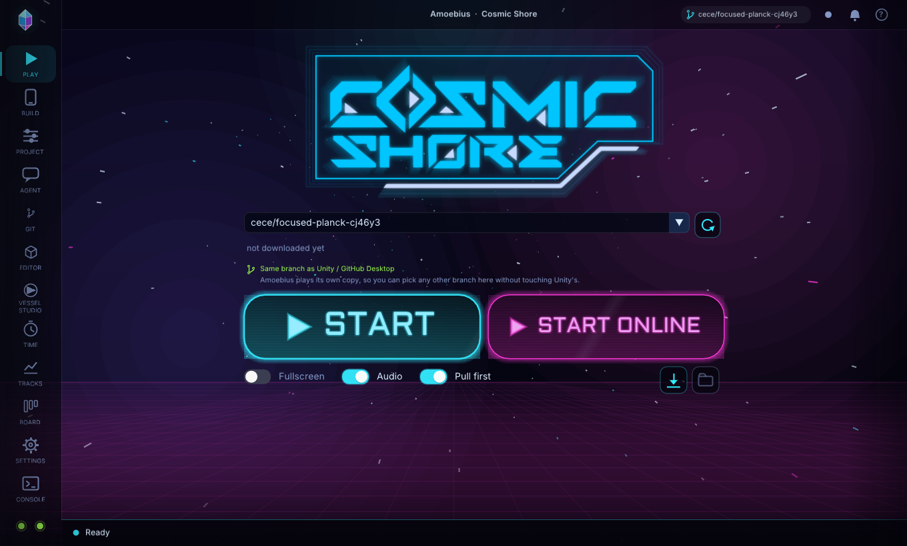

**Amoebius and Unity can be on different branches.** Amoebius plays its *own* copy of the repository
(the workspace), never your Unity checkout. Opened from Unity (**FrogletTools > Amoebius > Launch
Amoebius**), it is told where that checkout is and follows the branch Unity / GitHub Desktop has open:
PLAY shows *Same branch as Unity / GitHub Desktop*, and switches with you (checked every few
seconds). Pick any other branch and Amoebius plays that one instead, with your Unity checkout
untouched; **FOLLOW UNITY** goes back. A branch that exists only on your machine has to be pushed
from GitHub Desktop before Amoebius can fetch it.

The two dots at the bottom of the rail are git and .NET (hover for versions). The bar at the
bottom shows what is happening, a progress bar and CANCEL. The title bar shows the branch, the
agent's state (green: ready on your Claude plan), the notification bell and **?** (the tour).
The first start shows a one-minute tour of every page; **?** replays it.

## VESSEL STUDIO - the Vessel Studio and every artifact

The rail item was called STUDIOS until 2026-10-09; the page id is still `studios` (`--page studios`, which
Unity's **FrogletTools ▸ Amoebius ▸ Vessel Studio Page** passes). `--page studios:artifacts` opens it scrolled to the
artifact library (docs screenshots). `--page studios:hub` (or `studios:stoat`, any catalog id) also opens that studio
in its window as soon as the page is up: Unity's **FrogletTools ▸ Vessels ▸ Vessel Studio** passes `studios:hub`.

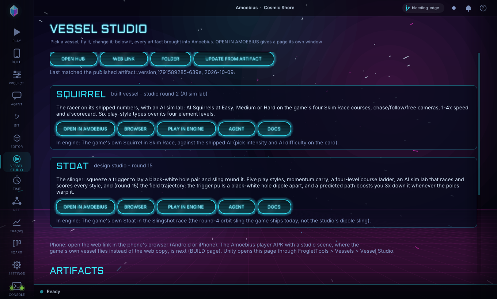

Pick a vessel and its studio opens: fly it on gamepad, keys or a phone's thumbs, switch its play-style types
and element levels, and read what each number does. The pages live in `Docs/Studios/VesselStudio/`; what every
surface opens is their **build** (`build_artifact.py`'s output), so the studio here is byte for byte the one on
claude.ai and the live mirror (/vessel-studio D34, below). Test steps: `Docs/Studios/PRISMA_TEST_STEPS.md`.

**The hub's cards** (/vessel-studio D35, 2026-10-10, the user: "look like the cards in the artifact / web hub"; it replaces
the picker). The page is the web hub's front page natively: the hub's lede, the hub's own row (OPEN THE HUB, OPEN IN
BROWSER, AGENT, DOCS), then one card per studio in a grid, exactly as `index.html` draws its bays: the preview (the
hub's live canvas, baked to `previews/<id>.png` by `bake_previews.cjs`), the name in the card's accent, the chip, the
summary, the spec rows. Each card's buttons come from `studios.json` `cardActions`, in the same order on every card
and in Unity's home: **Open studio →** (served, its own window) · **PLAY IN ENGINE** · **OPEN LIVE IN BROWSER** (no
TUNE IN UNITY: the artifact is the one source of truth, /vessel-studio D33); a button that does not apply stays in its place, disabled, and its
tooltip says why (`StudioCatalog.Applies`). Under them, the quiet per-studio links: in browser · agent · docs. Then
the fleet without a studio. Nothing on the page spells a studio's text or a card label (`DrawStudioCard`), so a studio
added to `studios.json` and the hub shows up with no launcher change; `StudioCatalogTests.TheShippedCatalogsCards_AreTheHubs`
and `parity_gate.py` hold the catalog to the hub. The artifact library below keeps the picker, card (`PickedCard`) and
action row (`ActionRow`). The studio is built from **the checkout Unity opened Amoebius from**
when Unity started it (`--clone`: Unity's branch), else from Amoebius's workspace when it has the studio, else from
that checkout (`StudioCatalog.PickRoot`), so nothing waits for the first START.

The actions:

- **OPEN IN AMOEBIUS**: the studio, built from the checkout and served by Amoebius (below), as its own window in the
  app mode of Edge (always on Windows 10/11) or Chrome.
  - It has no tabs or address bar.
  - It uses a window profile under Amoebius's data folder (`studio-window`), so the studio's layout and pop-out
    windows are remembered.
  - The URL ends in `#amoebius`: the pages' one host helper (`VesselStudioTheme.host()`) reads it; nothing visible changes.
  - With neither browser installed it falls back to the default browser.
  - `PRISMA_STUDIO_BROWSER_ARGS` adds browser flags (a GPU-less test box: `--use-gl=swiftshader --enable-unsafe-swiftshader`).
  - Code: `StudioCatalog.AppBrowserCandidates` / `AppWindowArgs`; `LauncherApp.OpenServedStudio` / `OpenStudioWindow`.
- **OPEN IN BROWSER**: the same served studio in the default browser. With no checkout yet it opens the live mirror
  (`mirror` in the catalog, else `StudioCatalog.DefaultMirror`), which is also a quiet link under the card.
- **PLAY IN ENGINE** (a studio with `engineMode` in the catalog): the game's own vessel.
  - Amoebius builds and starts the game as PLAY does.
  - It adds `--arcade MODE` for that one launch (`LauncherJobs.Play(extraArgs)`).
  - The player waits for the main menu, opens that arcade card and presses its Start
    (`Port/src/CosmicShore.Player/ArcadeAutoStart.cs`, through the same path as the `arcade` input verb).
  - The pilot presses Ready. First-run prompts on a new profile still come first.
  - `engineNote` says what the engine run is when it differs from the studio's design (the Stoat's game sling
    is still round 4's).

- **The list comes from data:** `Docs/Studios/VesselStudio/studios.json` (`id`, `name`, `file`, `kind`,
  `summary`, `docs`, optional `engineMode` and `engineNote`, plus `web` and `hub`). A test checks every
  `engineMode` is a `GameModes` member. A branch without it shows why, and how to switch. Adding a studio
  is a page plus a catalog entry; no launcher change. Read by `StudioCatalog` (tested in
  `tests/CosmicShore.Launcher.Tests/StudioCatalogTests.cs`, including "every listed page exists").
- **AGENT** starts an Amoebius Agent chat on that studio (or on the Vessel Studio as a whole, for ALL STUDIOS), in plan mode.
- **DOCS**: the vessel's doc (`docs` in the catalog); for ALL STUDIOS, the plan.
- **Links under the card**: the claude.ai artifact (`web`, else `StudioCatalog.DefaultWeb`; its decisions and requests are shared with everyone), the live mirror, the folder, and update from the artifact (an agent chat; needs the workspace). The line above them says what is being served (branch @ commit, port).
- **From Unity:** **FrogletTools > Vessels > Vessel Studio** opens the studio home in Unity (/vessel-studio D32); a card's
  **OPEN STUDIO** opens that studio SERVED by Amoebius (D34): the server of an Amoebius already running on Unity's checkout
  (`<data>/studio/server.json`), else Amoebius started with `--clone <checkout> --page studios:<file>`. Built from Unity's
  checkout and branch. **FrogletTools > Amoebius > Vessel Studio Page** opens this page (`--page studios`).

### The studio server: one build, and the artifact's backend (/vessel-studio D34)

`Port/src/CosmicShore.Launcher/Studio/`. Started the first time a studio opens; lives as long as Amoebius.

- **Build** (`StudioBuild`): the C# twin of `.claude/skills/vessel-studio/build_artifact.py`: the pages, studios.json,
  sync.js, the shared files and build.json from the checkout's branch (`git show`, so committed work: commit to see a
  change), into `<data>/studio/build/<time>-<sha>/`. Rebuilt only when the branch's commit changed. A test builds this
  repo both ways and compares every byte (`StudioBuildTests`).
- **Serve** (`StudioServer`): `http://127.0.0.1:<random port>/<random per-launch token>/<page>#amoebius`. Only
  127.0.0.1, only that Host header (no DNS rebinding), any other Origin or a cross-site fetch refused (403), the API
  only with our Origin, no CORS headers, `Referrer-Policy: no-referrer` (the token never reaches the font or three.js
  CDNs), `Cache-Control: no-store`. The one byte difference from the published build: a `<script src=".amoebius/bridge.js">`
  first in `<head>` (`StudioServer.WithBridge`), which `parity_gate.py` allows and nothing else.
- **Backend** (`Assets/studio-bridge.js` + `StudioServer.Api`): the same `window.claude.use()` the claude.ai viewer gives,
  so the pages do not know which host they are on beyond what is enabled:
  - `db`: `StudioStore`, one JSON file per collection under `<data>/studio/db/` (`decisions`, `jobs`, `requests`,
    `data/users/<id>`), add / doc get-set-update-delete / orderBy-limit, live queries polled. Firestore's rule that
    orderBy leaves out documents without the field holds. Kept on this computer, not shared with the artifact's store.
  - `user`: one local user per data folder (`<data>/studio/user.json`).
  - `sample` (Ask): `StudioAsk`, one read-only run of Amoebius's Claude Code CLI (plan mode, no Bash/Edit/Write/Web),
    the answer streamed back; the AGENT page's sign-in, model and API key.
  - `mcp` "Claude Code Remote": the session is Amoebius (`amoebius-local`, named in build.json so Sync needs no Start
    session). `send_message` naming a job runs it.
- **Sync jobs** (`StudioJobs`): what SKILL.md section 5 has a session do, done here: `sync_job.py` (needs Python 3)
  in the studio checkout, its log and result written into the job. The skill's limits, checked before Python runs
  and again by sync_job.py: never merge into or delete `bleeding-edge`, `Ys-bleeding-edge`, `main`, `master`;
  never delete the tools branch or the checkout's branch; branch names by `StudioJobs.BranchRe`; no force-push; one job
  at a time, 5 minutes each, `GIT_TERMINAL_PROMPT=0`. **Refresh** rebuilds the served studio from `origin/<branch>` and
  the page reloads onto it (OPEN IN AMOEBIUS goes back to the checkout's branch).
- Tests: `StudioServerTests.cs` (token, origin, db API, the session connector, sample, the job limits, the build).

- **Phones today** use the web pages. A studio scene inside the Amoebius phone player (the game's own vessel
  instead of the web copy) is the next step: `Docs/Studios/VESSEL_STUDIO_PLAN.md`.


### ARTIFACTS - the artifact library

Anything built as a claude.ai artifact, in any session, comes into Amoebius by its link
(`Docs/Artifacts/README.md`). The library is `Docs/Artifacts/artifacts.json`; Amoebius reads it every few
seconds (`ArtifactLibrary.Load`), so an import shows at once.

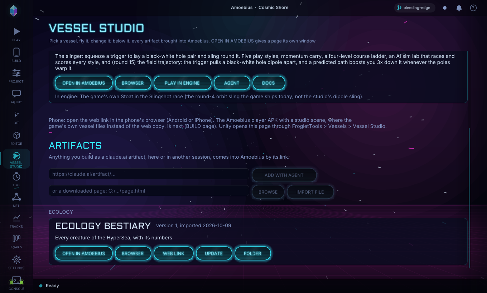

- **ADD WITH AGENT** (a pasted `https://claude.ai/artifact/...` link): an AGENT chat that runs
  `/amoebius-artifact <url>` (`ArtifactLibrary.ImportPrompt`): it saves every file of the artifact with the
  Artifact tool, imports them with `Tools/Build/amoebius_artifacts.py` and gates them. The change stays
  uncommitted in the workspace for the GIT page.
- **IMPORT FILE**: one downloaded page plus its link, no agent (`ArtifactLibrary.ImportPage`, the same schema
  the script writes). BROWSE is the Windows file dialog; elsewhere type the path.
- The same picker and one action row: **OPEN IN AMOEBIUS** (its own window), **OPEN IN BROWSER** (the live artifact on
  claude.ai, with the viewer's features), **AGENT** (an agent chat that re-imports it).
- The Vessel Studio is entry `vessel-studio`; **update from the artifact** under the studio card checks the published
  studio against the repo pages (normally every file `unchanged`) and the line under it names the version last
  matched.
- Tests: `ArtifactLibraryTests` (parse, path safety, IMPORT FILE add/update, the repo's own library).

## TIME - benchmarks

**BENCHMARK** times the game on this machine. Tick scenes and replays (REPLAY rows are the parity
harness's recorded inputs, `Port/parity/manifest.json`: they fly a real match, so they measure
gameplay rather than an idle scene), pick the length (10 s to 2 min at 60 fps), how many runs of
each (the median is kept), WINDOW (rendered, so GPU time counts) or HEADLESS (simulation only), the
window size, VSync and the .NET garbage collector's mode (default, low latency, or **A/B**: every item
in both, the LOW GC row compared with its default row). **RUN** builds the Release player if the workspace changed since the last
build, then starts one game per scene and run; each closes itself when its frames are done, writes
its session report, and the next one starts. Replays play in PLAY's save slot, so log in once from
PLAY first (a fresh slot stops at the birth-year prompt).

RESULTS shows one row per scene: frame time at the 50th and 95th percentile and the worst frame,
frames over 33 ms, the simulation's 95th percentile, GPU time (timer queries), load time (the scene's switch
to its first frame; hover for boot to first frame), GC pause per frame and
the frame count, each with its change against the previous benchmark on the same machine (green
faster, red slower). Every benchmark is kept in `%LOCALAPPDATA%\Amoebius\bench` and can be picked
from the history list. `Amoebius --auto bench:Menu_Main,MinigameSkimRace:600` runs a headless
benchmark unattended and closes Amoebius when it is saved.

## START ONLINE - playing with other players

**START** plays offline, on your own. **START ONLINE**, beside it, plays online the way the Unity
build does: the game signs in to Unity Gaming Services (UGS) as this profile's player, and its
parties, invites and matches go through **UGS Lobby** (who is online, parties, sessions) and **UGS
Relay** (the match traffic between machines). There is nothing to host, find or forward: UGS is
always there, and players on any network meet through it (`docs/MULTIPLAYER.md` §6.10). There is no
LAN or local-network play.

**Diagnostics**: press **F3** in any game for Amoebius's diagnostics overlay (FPS, frame, CPU and GPU time,
memory, scene, and online status: UGS sign-in, lobby, relay, ping and traffic; `ARCHITECTURE.md` §11.3).
SETTINGS > GAME > **Diagnostics overlay** starts every game with it shown.

SETTINGS > ONLINE:

- **UGS environment**: the UGS environment START ONLINE signs in to. Empty uses the branch's
  (`Network.UgsEnvironment` in `Port/ProjectSettings/AmoebiusProject.json`), else **`amoebius`**: a
  separate environment keeps Amoebius's lobbies apart from the Unity build's, whose netcode does not
  talk to Amoebius's. **It must exist in the UGS dashboard** (Project settings > Environments > Add);
  until it does, sign-in fails, the console says so, and START still plays offline.
- **UGS CHECK**: signs two test players in to UGS (the `relaycheck` profile, the same two every time),
  allocates on UGS Relay, joins by code and sends frames both ways (`CosmicShore --ugs-relay-check`).

Each player is their own UGS player. **+ PLAYER 2**, beside a running online game, starts a second
online game on this PC as the `player2` profile (its own save and UGS sign-in; a smaller window, no
sound, its console lines prefixed `[P2]`), so one person can party up with themselves through UGS:
ARCADE, the party panel's **+**, Invite, accept in the other window. **CLOSE P2** closes it (its window
first, so it writes its log; it is stopped only if it does not close within 5 s).

**The test's logs collect themselves.** Every online game writes a multiplayer test log when it
closes (`<data folder>/netlogs/net_<time>_<peer>.json`, peer `main` or `p2`): its network timeline
(sign-in, party, clients approved and leaving, refusals) and its console. Player 2 always writes one;
the main game does when it saw another player. When the last player has closed, a notification asks
**Send this online test's logs to Claude?** **SEND TO CLAUDE** adds them to your `bugledger/<user>`
branch, where the Unity editor's Send to Claude puts its logs. It never touches your checkout or
your branch, and never sends a log twice. **NOT NOW** keeps them; they go with the next send. Claude
reads them with `python3 Tools/Build/net_logs.py show 1`: every player in one timeline. Format and
rules: `Docs/DIAGNOSTICS.md` § "Multiplayer test logs".

## When Amoebius itself closes unexpectedly

An error nothing caught is written to `last-crash.txt` in the data folder (SETTINGS > TOOLCHAIN >
DATA FOLDER), and the next Amoebius shows it as a notification with **OPEN LOG**; the file is then
kept as `crash-<time>.txt`. Send that file with the report. (Before 2026-10-13 Amoebius closed every
time PLAY started the game on Windows: it read the game's process before the process had started.)

## TRACKS - Amoebius's memory of every run

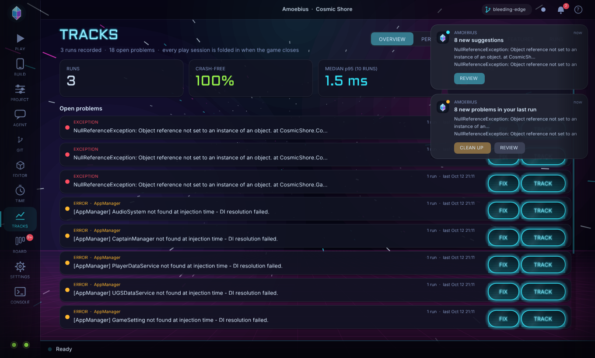

Every game started from PLAY writes a session report when it closes or crashes. Amoebius folds it
into **tracks** (`%LOCALAPPDATA%\Amoebius\tracks`): OVERVIEW (runs, crash-free rate, median
frame time, open problems), PERFORMANCE (a *Frame budget* card with simulation and render CPU,
allocations per frame and GC pause per frame, then each scene's 95th-percentile frame time per run
against the 60 fps line), AUDIO (sound events per run, events missing from the banks, unwired one-shots),
FEATURES (modes, vessels and scenes used) and RUNS. A problem is grouped across runs (numbers and
ids stripped), with its first and last sighting; one that stays away for three runs through its
scene goes *quiet*. A run whose steady GC pause tops 1 ms per frame is a performance problem too.
**FIX** hands a problem to the agent; **TRACK** puts it on the board.

## Notifications and clean-ups

After every run a banner (top right) says what the run found - a crash, new problems, a slower
scene, or a clean run - with one-click actions. Amoebius also watches for things it can clean up:
a stale git lock blocking updates, a failed build with stale outputs, low disk space. **It always
asks first**: every clean-up is a button on a notification, never automatic. The bell keeps the
history.

## BOARD - tasks and bugs

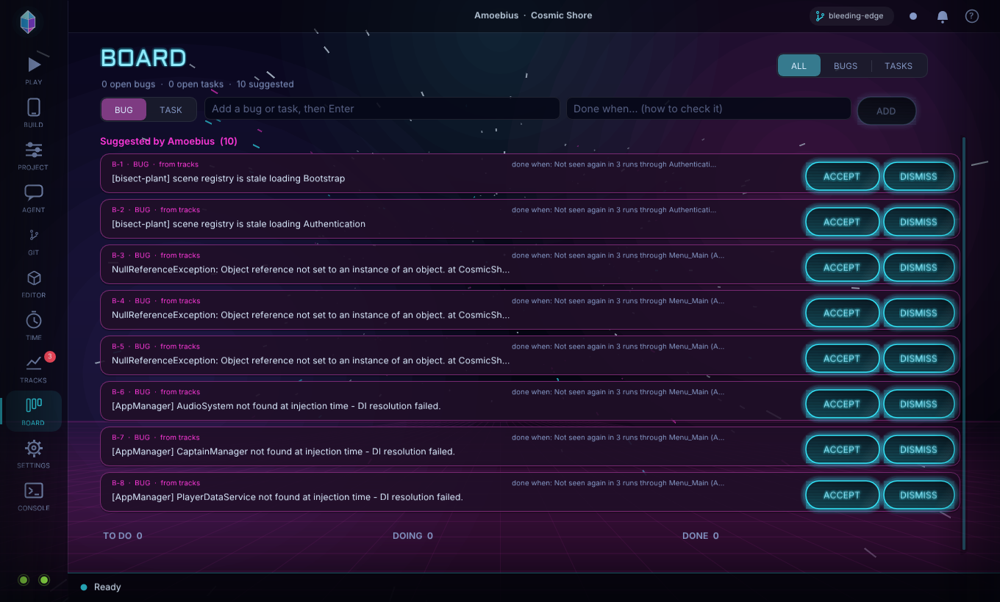

TO DO / DOING / DONE columns of bugs and tasks; click a card for its detail and to move it, or
hand it to the agent. Amoebius *suggests* items - problems from the tracks - and so can the agent (`amoebius_board_suggest`); a suggestion joins
the board only when you ACCEPT it.

Every card has a **done when** line: the check that proves it. Type one next to a new item's
title; the agent must give one with every suggestion. A bug that came from the tracks is checked by Amoebius itself after every run: when
the problem has stayed away for three runs through its scene, the card gets a green **MET** pill
and a notification offers MARK DONE (moving it stays your call). If the problem comes back, the
card loses MET, and a DONE card reopens to TO DO. A card in DOING tells the agent's brief that a
fix is in progress.

The board is `board.json` beside the tracks. A suggestion an agent makes while Amoebius is open shows up
within a second and survives Amoebius's next save (saves merge with the file instead of overwriting it).
If the file cannot be read, Amoebius keeps a copy as `board.json.corrupt-<time>`, says so in CONSOLE and
starts an empty board; the copy is never overwritten.
How it works, how to test it on Windows, and the scheduler that builds on it: [`PRISMA_BOARD_SCHEDULER.md`](PRISMA_BOARD_SCHEDULER.md).

## BUILD

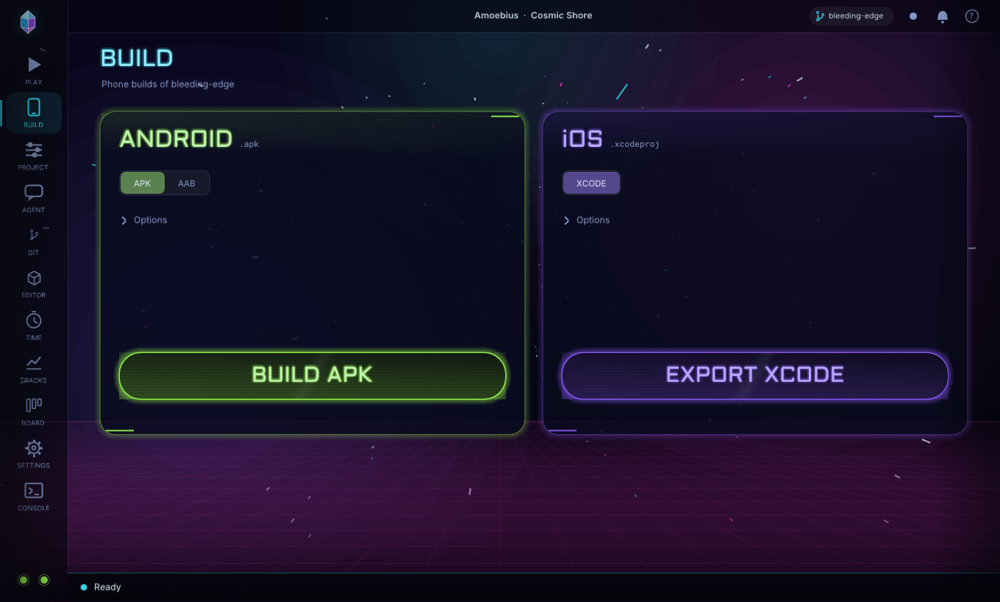

**Android** - APK (install directly) or AAB (Play Store). Options: CPU, keystore, debug.

**iOS** - picked with the switch on the card:

| Mode | Needs | Produces |
|---|---|---|
| **XCODE** (the default without a Mac) | nothing | `Builds/iOS/CosmicShore.xcodeproj` + player data, like Unity's iOS export |
| **THIS MAC** | a Mac with Xcode | a signed `.ipa` |

The GITHUB mode (an unsigned `.ipa` from GitHub's Mac, for Sideloadly) was retired on 2026-10-13
with the game's free-Apple-ID sideload path: TestFlight is the only route onto a phone
(`Docs/IOS_BUILD.md`). A settings file that still names it opens on XCODE.

## PROJECT - the engine's Project Settings

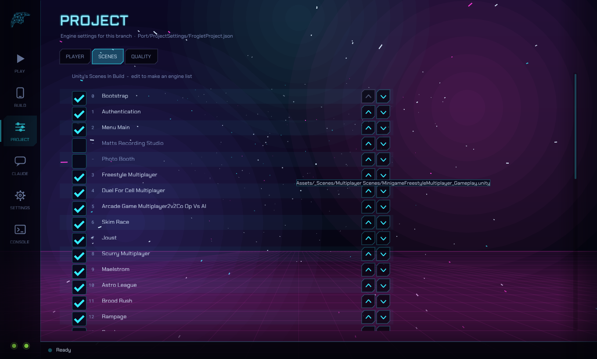

Unity keeps Player Settings and Build Settings in `ProjectSettings/`. The engine keeps its own in
**`Port/ProjectSettings/AmoebiusProject.json`**, so it never edits Unity's files. Every field is an
override: leave it empty and Unity's value applies (shown greyed in the field).

| Tab | Holds | Read by |
|---|---|---|
| **PLAYER** | company, product name, version, Android package + version code, iOS bundle id + build number | `cs-build` (APK/AAB/IPA/Xcode) |
| **SCENES** | Scenes In Build: enable, reorder (scene 0 boots). USE UNITY'S drops the override | `cs-build`, the game's scene list, the launcher's *Start in* |
| **QUALITY** | anti-aliasing (MSAA), render scale, texture filtering, vsync, frame cap | the player at startup |

Edits save as you make them. Commit the file to share them with the branch.

## Updating the launcher (and keeping old versions)

The launcher never updates itself without asking. When the selected branch has a newer launcher,
an **UPDATE** badge pulses on the rail (Amoebius checks at start and every 30 minutes); click it to
see what changed, then **UPDATE NOW** or **NOT NOW**. The new version is built from that branch's
own source in the workspace (no zip to download), the screen shows the build, and the launcher
restarts into it. If a check cannot answer (offline, or the selected branch was merged and
deleted), SETTINGS > ABOUT says why under CHECK. Launching from Unity (above) needs none of this:
it always builds what the checkout has.

SETTINGS > ABOUT shows this launcher's version and lets you **INSTALL** any branch, tag or
commit. Every version you install (and the
one you had before) is kept, and **USE** switches between them, so testers can each run a
different launcher.

## LOOK

SETTINGS > LOOK: eight backgrounds (synthwave, warp, starfield, nebula, aurora, the HyperSea
lattice, plain, or your own picture), six accent themes (Cosmic, and the Jade, Ruby, Gold, Ice
and Mono domain colours), motion speed (down to still), dim, and the intro and page animations.

## Play-session reports

Every game started from PLAY writes a report when it closes or crashes: scenes and time in each,
frame-time percentiles (overall and per scene), simulation and render CPU, the average cost and
allocations of each loop phase, GC collections and pauses, audio use, every distinct error,
warning and exception with its count, and the crash, branch and commit. They are kept in `%LOCALAPPDATA%\Amoebius\sessions` (the last
40). The CLAUDE page's LAST SESSION hands the newest one to Claude to analyse.

## AGENT - the Amoebius Agent, powered by Claude

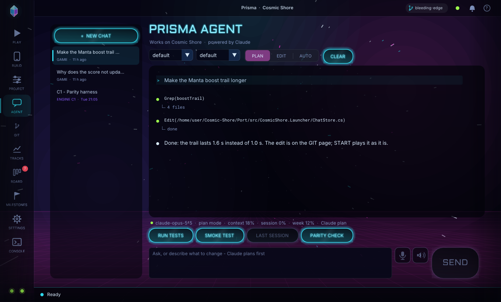

The **Amoebius Agent** works on the game (Cosmic Shore's code and content in `Assets/`) as it runs
in Amoebius, and it is refused any edit to Amoebius itself (`Port/`) in every mode - engine work (the
roadmap's milestones) is done in Claude Code at the repository root, not in Amoebius. It does what you ask and nothing more: it reads TRACKS (every
run Amoebius recorded) only when your question is about a bug, a crash, performance or a run, and
it does not go looking for engine problems on its own.

**Chats.** The list on the left holds every conversation, the way Claude Code keeps sessions:
**+ NEW CHAT** opens another, a click switches, the x deletes. Each chat has its own transcript,
its own Claude Code session (resumed on the next message, also after Amoebius restarts) and its own
context, and several can work at once - a pulsing dot marks the ones that are. FIX, AGENT and ANALYSE buttons elsewhere open a fresh chat for the
job. Chats are kept in `%LOCALAPPDATA%\Amoebius\chats`.

The layout follows Claude Code: a bullet per message and tool call, each tool's result folded
under it, to-do lists as checklists, the game's screenshots inline.

**Usage**, as Claude Code shows it. The status line under the transcript reads model, mode,
**context** (how full this chat's context window is), and on a Claude plan the **session** (5-hour)
and **week** limits. Click it (or type `/usage`) for the card: a bar for the context (tokens of the
model's window), one per plan limit with when it resets, and what the chats cost (on an API key
that is your bill; on a plan it is list price for reference). Claude reports the limits with
every reply, so they appear after the first one and are remembered.

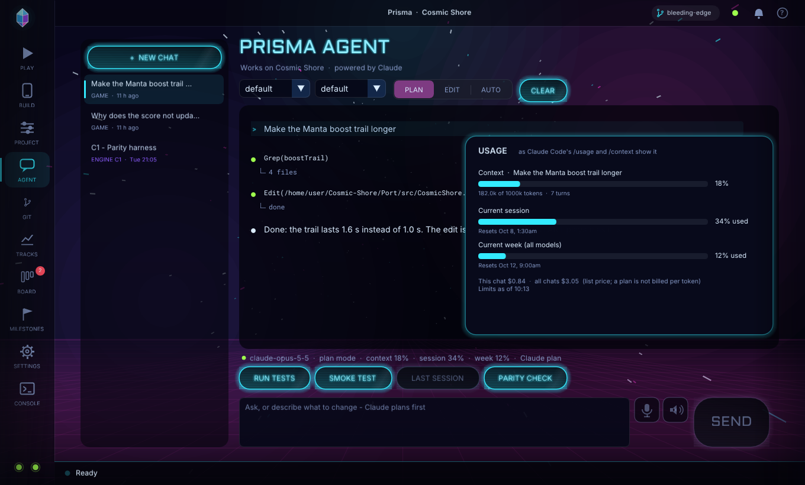

- **Model** and **effort** on the bar (default / fable / opus / sonnet / haiku; low to max).
- **PLAN**: Claude investigates (it may build, test and run the game) and answers with a plan
  card. **APPROVE + EDIT** or **APPROVE + AUTO** lets it build the plan; typing keeps planning.
  **EDIT** edits files directly; **AUTO** may also run any command, with Claude Code's permission
  checks off. AUTO is opt-in **per chat, per session**: choosing it (or APPROVE + AUTO, or `/auto`)
  asks first, the answer holds for that chat until Amoebius closes, and it is never saved - a
  restored chat, a new chat and a restart all start in PLAN or EDIT. **CLEAR** starts this chat over.
- **Chips**: RUN TESTS, SMOKE TEST (boots the game headless and reports every error), LAST
  SESSION, PARITY CHECK (compares one system with the Unity game, in plan mode).
- **Commands**: `/new /clear /rename TITLE /usage /plan /edit /auto /model NAME /effort LEVEL /test /smoke /session`.
  Up arrow recalls earlier messages.
- **Voice** (Windows): the microphone dictates into the box; the speaker reads replies aloud. Dictation
  uses Windows' modern recognizer (`Windows.Media.SpeechRecognition`, the same online model as
  Win + H), so it hears "Unity", "prism" and "vessel". It needs **Settings > Privacy & security >
  Speech > Online speech recognition** on (and the microphone allowed for desktop apps). If either
  is off, the mic falls back to the old offline System.Speech engine. The mic's tooltip names the
  engine that is listening and, when it falls back, the setting that would fix it. The modern
  recognizer exists only in a launcher built on Windows (`net10.0-windows10.0.19041.0`; elsewhere
  the project stays `net10.0`), in `Voice.cs`.

Runs the official **Claude Code** CLI in the workspace, so it reads (and, if allowed, edits) the
branch you are building. If it is not installed, the page offers INSTALL: it downloads Claude Code
(~250 MB, with progress), checks it against Anthropic's published checksum and sets it up. No Node
needed.

**Which account pays.** With a Claude Pro or Max plan, leave the API key empty and press
**SIGN IN** (SETTINGS > Claude, or on the AGENT page): a window opens for the browser sign-in,
and chat then runs on your plan. An **API key** is only for pay-as-you-go billing from
console.anthropic.com; when one is set it is used *instead of* the plan. Keys and tokens are shown
as dots; SHOW reveals them to check a paste. The API key and the GitHub token are kept in the OS's
credential store (Windows Credential Manager, the macOS Keychain, or the Secret Service on Linux;
`secrets.json`, readable by you only, where there is none), never in `launcher.json`, and the key
is passed only to the `claude` process. A `launcher.json` from before that moves its two secrets
into the store on the first start and is rewritten without them.

It is connected to the engine itself (the `amoebius` tools, `Port/CLAUDE.md`): Claude can
build the engine, start the game, take screenshots, click and type, and read or change live
objects - so "start the game and check the score panel updates" is a request it can carry out
and show you. Those tools never edit files, so PLAN may use them too.

## GIT - from the agent's edits to GitHub

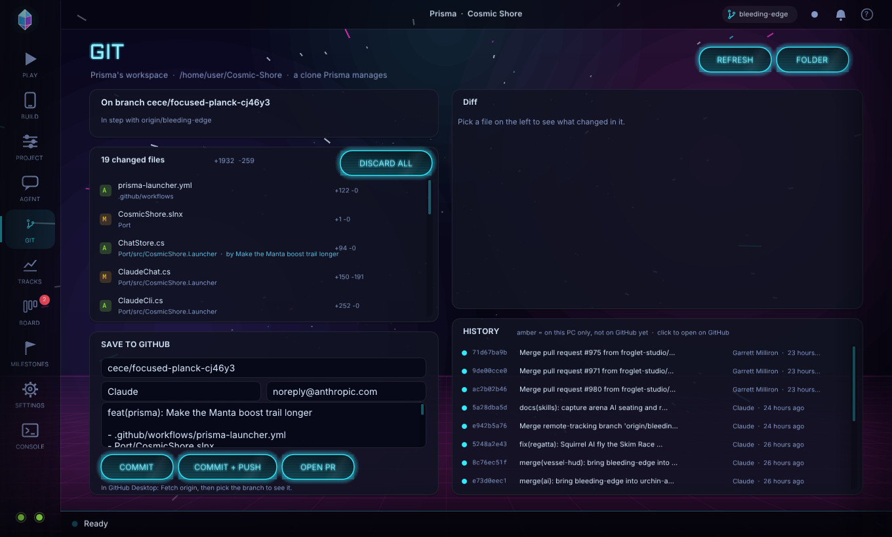

The agent edits files in **Amoebius's workspace**, which is not your own clone (it is a clone Amoebius
manages, or a worktree beside your clone - SETTINGS > SOURCE). Its edits stay there, uncommitted,
until you decide; the agent does not commit or push unless you ask it to. A notification says when
a chat changed files.

- **Left:** where the workspace is (START leaves it *detached* at the branch you play), then every
  changed file with its +/- lines and **which chat changed it**. Click a file for its diff;
  **REVERT** (hover, click twice) puts one file back; **DISCARD ALL** (click twice) throws every
  change away.
- **SAVE TO GITHUB:** a branch name (suggested from the chat, e.g. `amoebius/fix-score`), the author
  (read from your git config, which GitHub Desktop sets) and a message (suggested from the chats
  and files). **COMMIT** commits every change to that branch on this PC; **COMMIT + PUSH** also
  sends it to GitHub; **OPEN PR** opens GitHub's pull-request page for it into your branch.
- **Right:** the selected diff, and the history (amber commits are on this PC only).

**In GitHub Desktop:** with *Beside my clone* the workspace shares your clone, so a commit here
is a local branch in GitHub Desktop at once (you can push from there). With the managed clone,
push here, then **Fetch origin** in GitHub Desktop and pick the branch. Pushing from Amoebius uses
the GitHub token in SETTINGS > SOURCE (Contents: read & write) when one is pasted, otherwise git's own
sign-in. Every git step runs with prompts off, and Git Credential Manager honours that too. So when
GitHub refuses a push and no token is pasted, Amoebius pushes once more with prompts allowed. Git
Credential Manager then opens its GitHub sign-in (browser or window, up to 5 minutes) and keeps the
result for later pushes. GitHub Desktop's own git has no credential helper, and GitHub Desktop's
sign-in is not shared with other programs. With only GitHub Desktop installed, install Git for
Windows (it includes Git Credential Manager) or paste a token. The error names which case it was
(`SourceControl.PushRefused`).

**START never throws edits away.** With unsaved changes in the workspace, START plays them as
they are and skips pulling the branch (the CONSOLE says so); UPDATE refuses until they are
committed or discarded.

## EDITOR - tools, data sets, models

Amoebius's editor starts with what daily content work needs, for a game whose content already
exists (`ROADMAP.md` § M2). There is no hierarchy or scene inspector: scene and prefab edits are
the agent's job, through `cs-asset`. Everything on this page is read through the workspace's own
`cs-asset`, built once per session (a minute or two the first time; **REBUILD** after a pull or a
script edit), and every edit lands in the workspace, where GIT commits it.

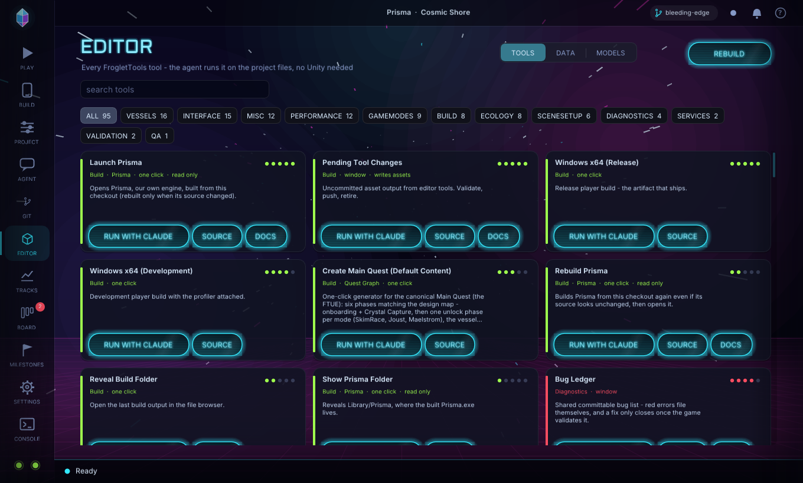

**TOOLS** - every FrogletTools menu item in the project (95 on 2026-10-08), read from source: its
category, importance (the dots), description, whether it is a window or one click, and whether it
writes assets. Filter by category or search. A tool Amoebius has a native version of shows **RUN**: it
runs that `cs-asset` command on Amoebius's workspace (output on CONSOLE, a writer's changes on GIT).
Every other tool shows **BUILD**: an agent chat that builds the native version - reads the tool's
source, plans first, then adds a `cs-asset` command, its test and an entry in
`Port/tools/froglet-tools/tools.json`, after which the card shows RUN. That chat may change only
cs-asset, its tests and that folder (the TOOL scope, enforced by deny rules), and says plainly when
a tool's job needs the running Unity editor. **SOURCE** opens the script, **DOCS** its documentation.

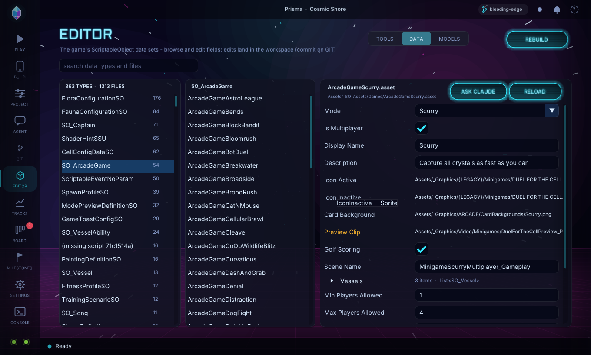

**DATA** - every ScriptableObject data file (1,313 in 363 script types), by type. Pick a file to
see its fields as Unity's inspector labels them, with the script's headers, tooltips (hover) and
ranges. Toggles, numbers (sliders where the script has a `[Range]`), text, enums, vectors and
colours are edited in place: each change is one `cs-asset set` that rewrites only that line. A
reference shows the file it points at; click a data file or model to open it. Keys the script no
longer has are amber (Unity ignores them). **ASK CLAUDE** starts a chat about the file. **+ NEW**
creates a data file of the selected type with the script's defaults, as Unity's Create menu writes it
(`cs-asset new-asset TYPE PATH`: same header and field order, a NativeFormatImporter `.meta` with a
fresh GUID), and opens it for editing.

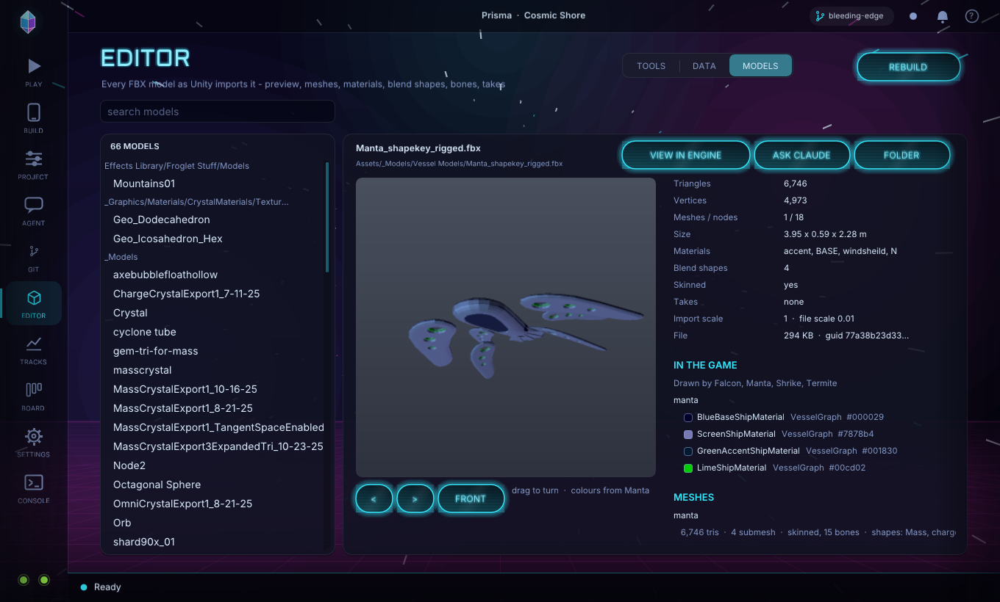

**+ IMPORT** brings a new model in (`cs-asset model-import`): the file is copied to the folder you
pick with a `.meta` in the import settings the project's models share (majority values, a fresh
GUID, no tables from another model), Amoebius's importer reads it back, and optionally a prefab that
holds it is written and loaded through the engine as proof.

**MODELS** - every model by folder: the 66 FBX files, and Blender (`.blend`) and Maya (`.ma`/`.mb`)
files, tagged BLENDER / MAYA. Unity cannot read those two either: its importer runs the installed
Blender or Maya in the background to export an FBX. Amoebius does the same (Unity's own export
settings), keeps the FBX until the file changes, and says so plainly when the application is not
installed. SETTINGS > TOOLCHAIN shows whether Blender and Maya were found, their version and path,
with **BROWSE** to point at one Amoebius did not find (passed on as `AMOEBIUS_BLENDER` / `AMOEBIUS_MAYAPY`).

Pick a model for a preview **in the colours the game draws it with**: the materials come from the
prefabs that draw its meshes (Manta's model from `Manta.prefab`, VesselGraph's `_Color1`), not from
the model file, whose own materials are usually placeholders. **Drag across the picture to turn it**
(24 views rendered once, about a second), **<** **>** step, **FRONT** faces it. Beside it: what
Unity's importer makes of it (triangles, vertices, meshes and nodes, size, materials, blend shapes,
skinning and bones, animation takes, the `.meta` import scale, warnings) and **IN THE GAME** - the
prefabs that draw it and each mesh's materials with shader and colour swatch. A model with blend
shapes (the vessels' Mass / Charge / Space / Time hull morphs, the crystals' spins) gets a **BLEND
SHAPES** slider each: let go and the turntable is drawn again with those weights; **ZERO** resets them.

**VIEW IN ENGINE** opens the model in Amoebius's own renderer - the real shaders, not the CPU
picture - on a turntable: drag to turn, wheel to zoom, right-drag to pan, **F** frame, **R** reset,
**Space** stop/start the spin, **Tab** the next prefab's materials (and the model's own). On screen:
the model, whose colours are shown and its size (top left), the controls (bottom left, **H** hides
them), a live slider per blend shape (top right, drag; **B** zeroes them) and its animation takes
(bottom right: **T** plays the next take, **P** pauses, drag the bar to scrub; a take that moves the
hull morphs moves their sliders too). No game scene loads, and the player is only rebuilt when the
workspace changed since the last build, so it opens in seconds (`CosmicShore --view-model FILE`).
**ASK CLAUDE** starts a chat about the model.

The agent has the same data through MCP: `asset_froglet_tools`, `asset_datasets`,
`asset_dataset`, `asset_model`, `asset_model_preview`.

## How START works

```
git fetch <branch>  ->  FMOD library from Git LFS  ->  dotnet build Port/src/CosmicShore.Player
                    ->  CosmicShore.exe --size ... [--fullscreen] [--scene ...]
                        (START: COSMIC_SHORE_NET=off; START ONLINE: signed in to UGS, Lobby + Relay)
```

Settings live in `%LOCALAPPDATA%\Amoebius\launcher.json` (its secrets in the credential store, above). The launcher never writes to your
own clone: *Beside my clone* uses a git worktree next to it.

**From the engine's earlier names (Prisma, before that FrogletEngine).** Nothing is lost on the
first start of Amoebius: the data folder (`%LOCALAPPDATA%\Prisma`, or `FrogletEngine`) moves over
whole, with settings, chats, sessions, tracks, the board, versions and the private .NET SDK; a
worktree already made as `<clone>-prisma` stays in use (it may hold the agent's uncommitted
edits); `PrismaProject.json`, the `PRISMA_DATA_DIR` / `PRISMA_BLENDER` / `PRISMA_MAYAPY` variables
and `prisma-session` reports are still read. An old launcher's UPDATE installs Amoebius over its own file,
which keeps its old file name (the build leaves `Prisma.exe` and `FrogletLauncher.exe` copies for
that updater to find; Amoebius's own updater deletes them).

## Testing the launcher itself

`Amoebius --page build --screenshot out.png --frames 40` renders a page and exits
(`--page project:1` opens a Project tab, `--page options:look` one settings section, `--page chat:usage` the usage card,
`--page editor:1:Assets/x.asset` an EDITOR tab with a data file or model open).
`AMOEBIUS_DATA_DIR` points all of Amoebius's data (settings, chats, tracks, versions) at another
folder - a second, separate Amoebius, or the tests. `Port/tests/CosmicShore.Launcher.Tests` covers
chats and their persistence, plan usage and the GIT page's git steps.
`--auto launcher-update:REV` / `launcher-use:SHORT` exercise the version flow. `--auto play|update|android|ios` presses the button on
its own and echoes the log; `--auto "chat:<message>"` sends one chat message; `--auto bench:A,B[:frames[:low|ab]]` runs a headless benchmark (optionally low-latency GC, or both) and exits;
